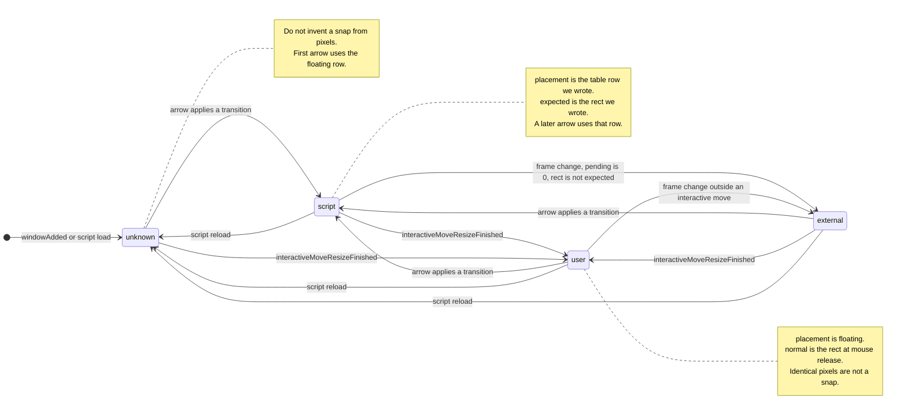

# Win11 Snap state-machine architecture

Status: draft investigation. No production behavior was changed for this document.
Target: KDE Plasma / KWin 6.8.2 on this machine (`kwin-6.8.2-2.fc44`), Wayland.
Date: 2026-11-01.

This report explains why the current script treats two windows with the same rectangle as the same snap, which of those decisions are heuristics, what KWin 6.8.2 can actually observe, and how to migrate without another round of one-off patches.

## 1. Current architecture and root cause

### What the script is

`win11-snap/contents/code/main.js` is one KWin script. It registers four shortcuts and, on each press, classifies the active window, looks up an action, and writes `frameGeometry` or the maximize/minimize flags. It does not call KWin Quick Tile to perform the snap. Quick Tile on this system follows the user's custom tile layout and does not produce Windows halves and quadrants.

Shortcut ownership is applied by `scripts/apply-plasma-config.sh`:

- KZones is disabled. Its Meta+Arrow actions are cleared.
- Plasma Maximize moves to Meta+PgUp. Minimize moves to Meta+PgDown.
- Quick Tile Meta+Arrow bindings are cleared.
- Win11 Snap binds `Meta+Up`, `Meta+Down`, `Meta+Left`, `Meta+Right` as primary shortcuts with alternate `none`, so one key is not stored twice in `kglobalshortcutsrc`.
- The script also calls `registerShortcut` for the same four chords. If the package is started by `Scripting.start` and again by `loadScript`, both callbacks run. The installer stops existing script objects, starts other plugins with Win11 Snap temporarily disabled, then `loadScript`s this script once. A 150 ms same-direction debounce in `handleDirection` is the remaining guard. That guard is global, not per window, and it also swallows a real second press of the same arrow inside 150 ms.

### The 11 × 4 table

Logical positions: `floating`, `maximized`, `minimized`, `left`, `right`, `top`, `bottom`, `topLeft`, `topRight`, `bottomLeft`, `bottomRight`.

`nextAction` in `main.js` is the table. `tests/permutations.mjs` repeats it as `NEXT` and checks that the two copies match. Actions that are not themselves positions:

- `cycleLeft` / `cycleRight`: on one screen, land on the opposite half. If `CycleAcrossScreens` is on and `screenCount() > 1`, the script also calls `slotWindowToLeftScreen` or `slotWindowToRightScreen`, then still applies a half. A no-op screen change cannot be distinguished from a successful one except by comparing `output` and origin, which the code does.
- `restore`: write `slot.normal` if present, otherwise a synthetic centered rectangle (about 45–60% of the work area).
- `minimize` / `maximized` / `floating` (unminimize).

The Up row that is in dispute:

| From | Action in the current table |
| --- | --- |
| `floating` | maximize |
| `maximized` | `top` if `SecondUpToTopHalf` (default), else stay maximized |
| `left` / `right` | `topLeft` / `topRight` |
| `top` | maximize |
| `bottom` | `top` |
| `topLeft` / `topRight` | stay |
| `bottomLeft` / `bottomRight` | expand to `left` / `right` |

### How a window is classified

Per-window memory is `snapState[internalId] = { region, normal }`. `normal` is the rectangle to restore.

`currentRegion` decides the row of the table:

1. Minimized flag wins.
2. `isMaximizedWindow` wins. That is true when `maximizeMode` is non-zero, or when the frame matches the full maximize area within 32 px. A restored window that merely fills the work area is therefore classified as maximized.
3. If the cached region still matches the frame within 32 px, that cache wins. This includes quadrants.
4. Otherwise `detectHalfFromGeometry` matches `left`, `right`, `top`, or `bottom` and **writes that region into the cache**.
5. Otherwise the window is `floating`, and the current frame replaces `normal`.

Step 4 is the geometry heuristic. Step 3 is cache-as-truth while the pixels still fit. Together they erase provenance.

### Restore, and what survives a series of keys

`rememberNormal` runs at the start of a non-restore action, and only while the cached region is still `floating` and the window is not maximized or minimized. Later snaps do not overwrite it. That part is the right idea: one original rectangle per snap chain.

`markApplied` sets a **global** `ignoreGeometry = 2`. The only consumer is `onUserFinishedAdjust`, which listens to `moveResizedChanged`. It does not listen to `frameGeometryChanged`. While the counter is positive, a move/resize signal is ignored but the counter is not decremented there; it is only assigned, never counted down per event. Two rapid snaps, or a snap on another window, share that flag.

`handleDirection` holds `handlingDirection` so a re-entrant call is dropped, then the 150 ms debounce.

On `workspace.windowRemoved`, the slot's region is set back to `floating`. The slot object is not deleted. A reused id would see a stale `normal`. On Wayland, `internalId` is a fresh UUID per window (`windowId` is undefined on this session), so reuse is unlikely. `closed` exists on the window and is not connected.

### Manual moves, maximize, minimize, close

| Event | What the script does today |
| --- | --- |
| Interactive move/resize | Only if `moveResizedChanged` fires, and only when `win.move` and `win.resize` are already false. Then region becomes `floating` and `normal` becomes the new frame. |
| Script `frameGeometry` write | Not observed directly. Hoped not to look like a user drag. `ignoreGeometry` is the hedge. |
| Another script or the app moves the window | Same path as a user drag if `moveResizedChanged` fires. If it does not, the old region remains whenever the new frame still matches it. |
| Maximize via title button | Not subscribed. Next key calls `isMaximizedWindow` and overwrites the cache to `maximized`. `normal` is kept only if it was already stored. |
| Minimize | `win.minimized` is read on the next key. `minimizedChanged` is not subscribed. Minimize from this script sets the cache itself. |
| Close | `windowRemoved` clears the region string. |
| Script reload | `snapState` is a JS global. It is gone. The next key reclassifies from flags and from half-geometry. |
| Output change | Not subscribed. Cached region is kept until the frame no longer matches. |

### How the tests establish state

`make test` loads `main.js` in a Node `vm` with a fake window and a fake `clientArea`. It does not talk to KWin. For each of the 44 cells it places the rectangle **and calls `setCachedRegion`**, then presses one arrow and checks the resulting rectangle. Named scenarios in `tests/permutations.mjs` do the same. A scenario with `seedCache` forces the cache. A scenario without it uses whatever `currentRegion` infers.

`make live` copies `main.js` into the installed script path, stops every `Script0`–`Script9`, and loads the script once. It drives one Dolphin window:

- A second temporary script assigns `frameGeometry`. The test fails if the read-back is not the requested rectangle (this check was added after earlier runs passed with the window still elsewhere).
- It then invokes the global shortcut and compares the rectangle to the expected region, with a 32 px tolerance.
- Scenarios that set `seedCache` are skipped. The live runner cannot see `snapState`.
- Cells other than `floating` are reached by real arrows (`right` then `up` for `topRight`, and so on), then the cell's arrow is pressed.
- `minimized` as a starting region is not live-tested. One `floating`+Down checks that minimize happens.
- Each case starts by placing the normal rectangle again, but it does not reset script memory except by whatever signals that place happens to emit.

Live success means "the rectangle matches." It does not mean "the logical placement was the one the case named."

### Where geometry is treated as snap state

These are the incorrect inferences. A matching rectangle is evidence the frame still agrees with a snap **this process remembers**. It is not evidence of how the window got there.

1. `detectHalfFromGeometry` promotes a full left, right, top, or bottom column into the cache. A window the user sized by hand becomes `right`. The next Meta+Up stores `topRight` as a script snap (`applySnapRegion` → `setCachedRegion`). The following Meta+Up stays, because `topRight`+Up is a no-op in the table.
2. `regionStillFits` keeps a cached quadrant after any external change that leaves the frame inside 32 px. A place, a reload that already had no cache, and a user drop onto the same corner are not distinguished once the cache says `topRight`.
3. `isMaximizedWindow` treats "fills the maximize area" as maximized even when `maximizeMode` is restore.
4. On the way into step 5 of `currentRegion`, a non-matching frame replaces `normal`. An external geometry change can destroy the restore rectangle and, in the same function, invent a new half snap.

That is the contradiction on the current Ptyxis window (`960,0` `960×540`, the top-right quadrant on this 1920×1080 output):

- If the script, or the half heuristic, last classified it as `topRight` and the frame still fits, Meta+Up stays. The live cell `topRight+up` expects that and passes.
- If nothing has claimed it, the same pixels are `floating`, and Meta+Up maximizes. The scenario "window filling top-right + Up → maximize" expects that and also passes, because the live placer tends to clear cache first.
- Both tests pass. They are not the same history. The screen only has the rectangle.

The half heuristic was added so a window already filling the right column would fold into the top-right on Meta+Up even after a reload or a manual size. Doing that writes script-owned state. The quadrant it produces then refuses Meta+Up. Removing the heuristic makes a hand-sized column maximize instead of folding. Both reports are the same missing field: provenance.

## 2. Verified KWin 6.8.2 capabilities

Verified by loading a temporary script (`/tmp/win11-api-probe.js`, since unloaded) that read `typeof` and `.connect` on a real window and on `workspace`, and by confirming the same signal names are present as strings in `/usr/lib64/libkwin.so.6.8.2`. Upstream headers were not fetched. The JS probe is the authority for what this process exposes.

### Present and connectable on a window

| API | Probe result | Use |
| --- | --- | --- |
| `frameGeometry` | object, writable (already used) | Apply a snap. Also fires for user, app, and our own writes. |
| `frameGeometryChanged` | connectable | Every geometry commit. Does not say who caused it. |
| `clientGeometry` / `clientGeometryChanged` | present | Client rect inside the frame. Not needed for the snap table. |
| `bufferGeometry` / `bufferGeometryChanged` | present | Surface buffer. Not a snap signal. |
| `interactiveMoveResizeStarted` | connectable | User (or KWin interactive) move/resize began. Our `frameGeometry` assignment does not start this. |
| `interactiveMoveResizeFinished` | connectable | User move/resize ended. This is the invalidation signal to use. |
| `interactiveMoveResizeStepped` | connectable | In-progress steps. No need to react to each step. |
| `moveResizedChanged` | connectable | What the script uses now. Coarse, and it also runs around operations that are not a finished user drag. |
| `move`, `resize` | booleans | True during an interactive operation. |
| `maximizedChanged`, `maximizedAboutToChange` | connectable | Maximize state changed, including from the title button. |
| `maximizeMode` | number (`0` on the sampled restored window) | Readable. `maximized` as a boolean is **undefined**. |
| `minimized` | boolean, writable | How the script minimizes today. |
| `minimizedChanged` | connectable | Not subscribed. |
| `fullScreen`, `fullScreenChanged` | present (`fullscreen` lowercase is undefined) | Separate from maximize. |
| `output`, `outputChanged` | `output` is a `LogicalOutput` object | Screen identity for this window. `screen` is undefined. |
| `internalId` | object, stringifies to `{uuid}` | Window identity on this Wayland session. |
| `pid` | number | Not unique per window. |
| `closed` | connectable | Window is going away. `windowClosed` is undefined. |
| `tile`, `tileChanged` | signal connectable; `tile` was `null` on the sampled window | Custom tiling, not Quick Tile mode. Null means "not in a custom tile." |
| `quickTileModeChanged` | connectable | Fires when KWin's quick-tile mode changes. |
| `quickTileMode`, `requestedQuickTileMode` | **undefined** | The mode cannot be read from the script. The signal alone is not a state value. |
| `setMaximize(h, v)` | function | Already used. |
| `minimize()` / `unminimize()` | undefined | Assignment to `minimized` is the available write. |
| `captionChanged`, `desktopsChanged`, `activitiesChanged`, `opacityChanged` | connectable | Not useful for snap provenance. |

### Present on `workspace`

Connectable or callable: `windowAdded`, `windowRemoved`, `windowActivated`, `screensChanged`, `currentDesktopChanged`, `virtualScreenSizeChanged`, `virtualScreenGeometryChanged`, `clientArea`, `windowList`, `stackingOrder`, `activeWindow`, `activeScreen`, `screens`, `slotWindowMaximize`, `slotWindowQuickTileLeft/Right/Top/Bottom`, `slotWindowToLeftScreen`, `slotWindowToRightScreen`.

Not on the wrapper: `windowMinimized`, `windowUnminimized`, `numScreens`, `numberScreens`, `outputAdded`, `outputRemoved`, `outputsChanged`. Screen topology is `screensChanged` plus the virtual-screen signals, and per-window `outputChanged`. `screenCount()` in the script already falls back to `1` when `numScreens` is missing; `workspace.screens.length` is the path that works here.

### What can be distinguished

| Source of a geometry change | Reliable observation |
| --- | --- |
| This script | Only by bookkeeping. Set a per-window `pending` count immediately before the write. `frameGeometryChanged` while `pending > 0` is ours. There is no KWin flag that says "a script wrote this." |
| User interactive move or resize | `interactiveMoveResizeStarted` then `interactiveMoveResizeFinished`. This does not fire for `frameGeometry` writes from a script. |
| KWin or another client, outside an interactive move | `frameGeometryChanged` with `pending == 0` and no interactive session in progress. The cause (app, rule, another script, output layout) is not identified. |
| Script reload | Not an event with history attached. The new script instance has an empty `snapState`. Old windows are still in `windowList()`. Their history is unknown. |

`quickTileModeChanged` cannot fill the gap. The signal is visible and the value is not. Adopting Quick Tile as the snap engine is also the wrong semantics: this machine's quick-tile layout is custom, which is why the script writes `frameGeometry` itself.

There is no script API here for a durable per-window store. `readConfig` reads the script's kcfg. Reload amnesia is a platform limit unless a later phase adds an external helper. Reconstructing "we snapped this" from the rectangle after reload is the heuristic this design rejects.

`moveResizedChanged` is a poor substitute for the interactive pair. It is what the script uses, it does not carry a reason, and the global `ignoreGeometry` flag tries to blind it after our own writes.

## 3. Proposed state model

Geometry stays a measurement. Placement is a decision the script made, or an explicit "we do not know."

Minimal slot, keyed by `String(internalId)`:

| Field | Why it is required |
| --- | --- |
| `placement` | The table row. `unknown` is legal and is not a synonym of `floating`. |
| `provenance` | `unknown`, `script`, `user`, or `external`. This is the field that separates the two top-right windows. |
| `normal` | Rectangle to restore. Captured only when a `script` transition leaves a `user` or `unknown` floating window. Never replaced by a later snap. Cleared when the user finishes an interactive move. |
| `expected` | The rectangle (or maximize/minimize mode) the last `script` transition applied. Used only to recognize our own `frameGeometryChanged`. |
| `pending` | How many geometry notifications this window still owes us. Replaces the global counter. |
| `output` | Identity of `win.output` at the last `script` transition. Compared when `outputChanged` or `screensChanged` fires. |

Not stored:

- `previous` and `lastTransition`. The table is a function of `placement` plus the arrow. History beyond `normal` does not change the next arrow. Keep them in a log line if a phase needs diagnosis.
- A copy of the whole transition table inside the slot.
- Quick-tile mode. It is not readable.

`unknown` means "no trustworthy history in this script instance." The first arrow on an `unknown` window uses the **floating** row and does not first rewrite `placement` to `left` or `right` because the frame happens to match. After that arrow, provenance becomes `script`.

The two windows in the brief:

| Window | Pixels | `placement` | `provenance` | Meta+Up |
| --- | --- | --- | --- | --- |
| Dropped by the user in the top-right quadrant | quadrant | `floating` | `user` | maximize |
| Right half, then Meta+Up from this script | same quadrant | `topRight` | `script` | the table's corner rule (today: stay) |

They are not collapsed. A third case, "frame matches the right half and this instance never snapped it," stays `unknown` or `user`. It does not become `script`/`right`. Whether Meta+Up on that third case should maximize or fold is a product rule (section 4), implemented as a labeled policy, not by overwriting provenance.

Placement values stay the existing 11 names plus `unknown`. Provenance is the new axis. Invalidation sets `placement` to `floating` and `provenance` to `user` or `external`. It does not set `placement` to whatever region the new rectangle resembles.

## 4. Transitions and reconciliation

### On an arrow

1. If `provenance` is `script` and `expected` still matches the frame (32 px) and the output is unchanged, use `placement` as the table row.
2. If `provenance` is `user`, the row is `floating`, regardless of resemblance to a quadrant or a column.
3. If `provenance` is `unknown` or `external`, the row is `floating`. Do not call `detectHalfFromGeometry`.
4. Optional policy, off unless explicitly enabled after the Windows check below: if the frame matches a **half** and provenance is not `script`, use that half as the row for this key only, and record the result as `provenance = script`. Document it as a heuristic. Do not apply it to quadrants.
5. Remember `normal` only when leaving `floating`/`unknown` via a script action that is not restore or minimize.
6. Apply the action. Set `placement`, `provenance = script`, `expected`, `output`, and `pending`.

The corner rule is not decided here. `topRight` + Up remains "stay" until section 4's experiment says otherwise. The architecture makes that a one-cell change that does not require lying about other windows.

### Reconciliation

| Observation | Update |
| --- | --- |
| `interactiveMoveResizeFinished` | `provenance = user`, `placement = floating`, `normal = frame`, `expected = null`, `pending = 0`. Ignore steps that arrive while `pending > 0` only if we started an interactive move, which we do not. |
| `frameGeometryChanged` and `pending > 0` | Decrement `pending`. Keep `placement`. |
| `frameGeometryChanged`, `pending == 0`, not inside interactive move, rect differs from `expected` | `provenance = external`, `placement = floating`. Leave `normal` as it was if provenance was `script` and the user has not released a drag. If the change is large, keep `normal` so a later restore still has the pre-snap rect; the chain is already broken, and inventing a new `normal` from the foreign rect is what step 5 of `currentRegion` does today. |
| `maximizedChanged` we did not request | If `maximizeMode != 0`, `placement = maximized`, `provenance = external`. If it returns to 0, `placement = floating`, `provenance = external`, and do not infer a half. |
| `minimizedChanged` we did not request | Same pattern with `minimized`. |
| `closed` or `windowRemoved` | Delete the slot. |
| `outputChanged` or `screensChanged` | If `expected` no longer matches `clientArea` for `placement`, set `provenance = external` and `placement = floating`. Do not retarget the snap onto the new output automatically. `CycleAcrossScreens` remains an arrow behavior, not a hotplug behavior. |
| Script load | Every existing window is `unknown`. Do not scan frames to recreate `script` placements. |

`pending` is per window. The global `ignoreGeometry` goes away. The duplicate-shortcut guard should become "this window already applied this arrow at this timestamp," or, better, the installer invariant "one script instance," with the debounce only as a backstop that does not apply across different arrows and does not need to be 150 ms once double registration is gone.

### What this deliberately does not do

A hand-sized right column is not silently stored as a script snap. Meta+Up maximizes it, as a floating window. That regresses the behavior added for "column that we did not snap should still fold." That regression is accepted until the Windows experiment says hand-sized columns are snaps. The optional half policy above is the only place that behavior can return, and it must set `provenance = script` on the **result**, so the following corner is an honest script snap rather than an accident of pixel matching.

## 5. Windows 11 reference, separated by evidence

This environment cannot run Windows 11. Nothing in this section is an observation from a Windows session.

### Documented, and consistent with more than one source

- Win+Left / Win+Right snaps to that half. Microsoft's keyboard snap page describes holding the Windows key and changing position with the arrows.
- Win+Up on a normal restored window maximizes. Win+Down minimizes a restored window and restores a maximized one. Microsoft Press has published this for current Windows.
- With Snap left on, Win+Up on an already maximized window snaps to the **top half** and offers Snap Assist. This is a reported Windows 11 change from Windows 10, where a second Up did nothing (NFBCS list, 2024, describing a maximized window). The script's `SecondUpToTopHalf` matches that report. It is not something we have reproduced locally.
- A side snap followed by Up/Down moves to the corner of that side. A Super User report (2024) describes Win+Up after a left snap landing on the top half or the top-left quarter, which is the same family of behavior as our `left`+Up → `topLeft`. The report is one user's 4K display, not a matrix.

### Assumed while implementing, not verified here

The entire `NEXT` table was written from those secondary sources and then frozen by tests. In particular, nobody on this project has recorded Windows coordinates for:

- `topRight` + Up stays in the corner, versus maximizes, versus moves to the top row.
- `topRight` + Down returns to the right column (what we do) versus restores or minimizes.
- `bottom` + Down minimizes (what we do) versus restores.
- Same-arrow cycle: half → opposite half → original rectangle, and the multi-monitor continuation of that cycle.
- Restore returns to the pre-snap rectangle rather than a centered default. This matches how DWM is generally described. It was not measured here.
- A window **manually resized** to a half or a quadrant, with Snap Assist never shown, follows the snap table. Windows may treat a drag-to-edge as a snap and a plain border resize as restored. Those are different provenances. Our half heuristic merges them.

### Intentional KDE simplification already in the tree

- No Snap Assist, Snap Layouts, Snap Groups, or Win+Z.
- No Win+Shift+Left/Right (move to the other monitor keeping size).
- Opposite arrow from a side restores, which is the usual Windows description, implemented as `restore` to `normal`.
- One-monitor cycle flips to the other half instead of moving to a monitor that is not there.
- Synthetic centered restore when `normal` was never captured.

### The disputed Up path

Do not edit a test to match the code, and do not edit the code to match the latest keypress, until this is measured.

On Windows 11, Snap enabled, one monitor, record `x,y,width,height` before and after each press, and write down whether Snap Assist appeared.

1. Restored window, clearly not a half or a quadrant. Win+Up. Expect maximize if the public shortcut description holds.
2. From that maximized window, Win+Up again. Record whether the result is the top half.
3. Restore. Drag the **borders** until the window exactly fills the right half. Do not drag the title bar to the edge. Win+Up. Then Win+Up again.
4. Restore. Win+Right (keyboard snap). Win+Up. Win+Up again.
5. Restore. Drag the title bar to the right edge so Snap Assist appears. Win+Up. Win+Up again.
6. From the top-right result of step 4, Win+Down, Win+Left, and Win+Right, each from a fresh step-4 setup.
7. Keyboard-snap to the left half, then Win+Left, then Win+Left again. Record the monitor and the rectangle, including a second monitor if one is attached.
8. After step 4, use the opposite arrow or Win+Down until the window is restored. Compare to the rectangle from before step 4.

Steps 3, 4, and 5 are the provenance experiment. If 3 and 4 differ, Windows is doing what this design proposes, and our half heuristic is the bug. If 3 and 4 agree, a labeled half policy is faithful and the corner's second Up is whatever step 4's second Up did. If step 4's second Up maximizes, the table cell `topRight`+Up is wrong and should change in its own phase, with the tests changed to the measured result rather than to the current script.

The Ptyxis window on this machine is step 4's result or step 3's result, and the script cannot tell which. Meta+Up stays because the cache says `topRight`. That is the implemented cell, not a failed key delivery.

## 6. Testing

### What the current tests actually prove

`make test` proves that `main.js` and `tests/permutations.mjs` implement the same table, and that a fake window's rectangle follows that table when the test is allowed to set the cache. It does not prove Windows behavior. Several fixtures encode the heuristic (`filled right column` classifies as `right`; `filled top-right` classifies as `floating` unless `seedCache` is set). A green run means the heuristic and the table agree with themselves.

`make live` proves that, on this session, invoking the shortcut changes Dolphin's rectangle to the expected one **given the current heuristic and whatever cache the previous case left behind**. It checks the starting rectangle. It does not check starting provenance. `seedCache` cases, which are the ones that distinguish "same pixels, different history," are skipped. Reloading at the start of the run deletes history on purpose, then the tests rebuild it with arrows or with a foreign `frameGeometry` write. A foreign write is not a script snap and is not a user drag. It is a third source, and today it sometimes clears `moveResizedChanged` state and sometimes does not.

Problems already hit:

| Problem | Status in the current tree |
| --- | --- |
| Duplicate shortcut handlers advance two states per press | Installer tries to load once. Debounce hides a second call within 150 ms. Still global. Not covered by `make live`. |
| Live setup did not land, assertion still passed | The placer now fails the case if read-back mismatches. Older passes before that check are not evidence. |
| Assertion ignores the starting logical state | Still true. Only the rectangle is read back. |
| State leaks across cases | One Dolphin, one `snapState`. A new place does not reset the slot. A following case that needs `unknown` does not get it. |
| Floating pixels versus a script snap | Separated in unit scenarios via `seedCache`. Not observable in `make live`. |
| Reload wipes history | `make live` reloads at start. It never asserts post-reload behavior of a window that was already snapped. |

### Tests to add later, without rewriting today's expectations in place

Keep the current 44-cell file as the regression net for the table as it exists. Add new tests beside it.

Unit tests, still in the `vm`, one slot per case:

- Start `provenance = user` and a quadrant rectangle. Up yields maximize. `provenance` becomes `script`, `placement` becomes `maximized`.
- Start `provenance = script`, `placement = topRight`, same rectangle. Up yields whatever the table cell says. Assert `placement` after the call, not only the rectangle.
- Start `provenance = unknown` and a right-half rectangle. Up yields maximize, and the slot does not become `right` before the action. This is the test the half heuristic fails today. It belongs in the phase that removes the heuristic, not as a silent edit to `class:filled-right-column`.
- `interactiveMoveResizeFinished` on a `script`/`topRight` window sets `user`/`floating` and replaces `normal`.
- `frameGeometryChanged` with `pending = 1` does not change `placement`. A second change with `pending = 0` sets `external`/`floating` and keeps the old `normal`.
- Two `handleDirection("left")` calls on one script instance move one step. A second script instance is an installer test, not a unit test.

Live tests, one transition each:

- Read the rectangle before the key and abort if it is wrong (already done).
- Expose the slot to the test through a query that is not a shortcut. A practical option that needs no new dependency: the script answers a `callDBus` method on a small well-known name, or writes one line when a test-only shortcut `Win11 Snap: Dump` is invoked. The live test reads placement, provenance, and `normal`.
- Build script history only with arrows. Build user history only with a real interactive move, or by calling a test hook that runs the same function `interactiveMoveResizeFinished` will run. Do not use a foreign `frameGeometry` write as a stand-in for either.
- Reload the script in a dedicated case and assert every surviving window is `unknown` and that the next Up maximizes.
- Run cases on a fresh slot. A dump-and-reset hook is enough. Stopping unrelated KWin scripts, which `make live` does today, should stop.

## 7. Compatibility boundary

In order:

1. Arrow transitions for a window this script snapped, using the table, including restore to `normal`.
2. A user move and a script snap with the same resulting rectangle stay different. Meta+Up follows provenance, not the rectangle.
3. Restore uses the pre-snap rectangle captured at the start of the chain.
4. `interactiveMoveResizeFinished` ends the chain and becomes the new `normal`.
5. Title-bar maximize and minimize update placement without being reread from pixels on the next key. `maximizeMode` and `minimized` are the signals. "Fills the work area" stops being a maximize test.
6. Output and virtual-screen changes drop `script` placement to `external`/`floating` instead of pretending the old half still applies. Moving a snap to another monitor when the user presses the cycle arrow stays. Doing it on hotplug does not.

Deferred: Snap Assist, Snap Layouts, Snap Groups, Win+Z, Win+Shift+arrows, coordinated resize of neighboring windows, and persistence of slots across script reload or logout.

Platform limits, not heuristics to paper over:

- No readable quick-tile mode, and Quick Tile does not match this table on a custom layout.
- No causal tag on `frameGeometryChanged`. Pending-count bookkeeping is the substitute.
- No per-window durable store in the script engine. Reload means `unknown`.
- `numScreens` is absent. Use `workspace.screens`.
- A foreign compositor or the application can resize without an interactive session. That is `external`, and the snap chain ends.

## 8. Migration plan

Each phase is shippable and testable. Phases 0–1 do not change key behavior. Phase 2 does, and it will fail specific current live scenarios on purpose. Those scenarios get new neighbors; they are not quietly retargeted.

### Phase 0 — this document

No code change.

### Phase 1 — observe, do not decide differently

Subscribe to `interactiveMoveResizeStarted`, `interactiveMoveResizeFinished`, `frameGeometryChanged`, `maximizedChanged`, `minimizedChanged`, `outputChanged`, `closed`, and `screensChanged`. Log placement, provenance, and the arrow. Keep `currentRegion` as it is so behavior stays. Add the slot fields with `provenance` mirrored from today's decisions (`script` after `applyAction`, `user` after the existing drag reset, `unknown` after load) without letting the new fields affect `nextAction` yet. Confirm in the log that a script write and a title-bar drag produce different event sequences on this machine.

Exit: a drag logs `user`; a Meta+Right logs `script` and a `frameGeometryChanged` accounted for by `pending`.

### Phase 2 — provenance affects the row

`currentRegion` uses section 4. Delete the cache write inside `detectHalfFromGeometry` (the function can remain unused). `unknown`, `user`, and `external` take the floating row. `script` with a matching `expected` keeps `placement`.

This changes two visible behaviors:

- A window that fills a half, but was not snapped by this script instance, maximizes on Meta+Up.
- After reload, the same is true until the user snaps again.

Existing live scenarios "right column + Up → top-right" and "left column + Up → top-left" are exactly the heuristic. Leave them in place so the diff is obvious, and add the new provenance tests beside them. Do not change their expected rectangles in the same commit as the code if the Windows experiment is still open. If the experiment later shows Windows folds a hand-sized column, enable the labeled half policy in a follow-up and point those scenarios at it.

Exit: unit tests show the two top-right histories diverge. A manual drag of a snapped window clears `script`.

### Phase 3 — per-window pending and maximize/minimize signals

Remove the global `ignoreGeometry`. Drive `pending` from `frameGeometryChanged`. Honor `maximizedChanged` and `minimizedChanged` when `pending` is 0. Stop treating a full-work-area frame as maximized unless `maximizeMode` says so.

Exit: title-bar maximize during a snap chain logs `external` / `maximized` and the next Down restores or minimizes according to the table for `maximized`, not for the old quadrant.

### Phase 4 — live harness reads the slot

Add a dump hook. Teach `make live` to assert provenance and placement, to reset the slot between cases, and to stop unloading every other script. Add the reload case.

Exit: a live case fails if the rectangle is right but provenance is wrong.

### Phase 5 — table cells only after Windows evidence

Change individual `NEXT` cells, starting with `topRight`+Up and `topLeft`+Up if step 4 of the experiment says the second Up maximizes. Update the duplicate table and the tests in that commit, citing the recorded rectangles. No other heuristic changes in that commit.

### Risks and open questions

- Phase 2 will look like a regression to anyone who sizes a window to a half and expects Meta+Up to fold it. That is the behavior the last patch added. It is the behavior that makes the following quadrant ignore Meta+Up.
- `interactiveMoveResizeFinished` might also run for keyboard-driven interactive resizes KWin starts itself. Phase 1's log is what tells us. If our own `setMaximize` or `frameGeometry` write ever emits it, `pending` must cover that path or we will clear `script` on every snap.
- `frameGeometryChanged` can fire more than once per write. `pending` has to be measured in Phase 1, not guessed as `2`.
- `output` object identity may change across a screen reconfigure even when the physical monitor did not. Compare a stable name if the object exposes one; the probe showed an object, not a string.
- The 150 ms debounce will keep hiding double registration until Phase 4's installer check, and it will keep eating fast same-arrow cycles. Narrow it only after a live test shows a single `registerShortcut` instance.
- Multi-monitor cycle is implemented and untested on this one-output machine. Do not "fix" it during provenance work.
- Persistence across reload is out of scope. Anyone who needs a snapped window to remember its corner after the script is reloaded will see `unknown` and a maximizing Meta+Up. That is the honest failure.

### Compatibility compromises to state in the README when Phase 2 lands

- A rectangle is not a snap. Only a snap performed by this script instance is a snap.
- After the script is reloaded, every window is unsapped until the next arrow.
- Meta+Up on a corner this script snapped to follows the Windows table cell currently in `nextAction` (`topRight` and `topLeft` stay) until a measured Windows trace says otherwise.
- Hand-sized halves are floating unless the optional half policy is turned on.
- Snap Assist, groups, and Win+Shift+arrows are not implemented.
